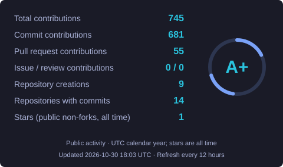
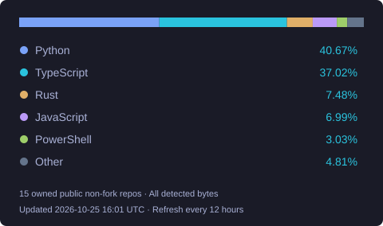

<div align="center">
  

  <a href="https://www.linkedin.com/in/faraz-hussain-mirbahar/" target="_blank" rel="noopener noreferrer">
    
  </a>
  <a href="mailto:farazhussain5000@gmail.com" target="_blank" rel="noopener noreferrer">
    
  </a>
  <a href="https://faraz-hussain-portfolio.vercel.app/" target="_blank" rel="noopener noreferrer">
    
  </a>
  <a href="https://www.instagram.com/asteroidcrib729/" target="_blank" rel="noopener noreferrer">
    
  </a>
  <a href="https://x.com/asteroidcrib729" target="_blank" rel="noopener noreferrer">
    
  </a>
</div>

---

## 👨‍💻 About Me

```js
const Faraz_Hussain = {
  role: 'Full-Stack Developer',
  location: 'Karachi, Pakistan',
  background: 'Software Engineering Graduate',
  currentFocus: [
    'Full-Stack Web Development (FastAPI, Next.js, React)',
    'Relational & Cloud Databases (PostgreSQL, Supabase, T-SQL)',
    'Secure Authentication & API Architecture',
    'AI-Assisted Development Workflows',
  ],
  openTo: [
    'Freelance & Contract Opportunities',
    'Open-Source & Collaborative Engineering',
    'Impactful Backend & Full-Stack Projects',
  ],
  aspirations: [
    'Long-Term Engineering Excellence & Financial Independence',
    "Fully-Funded Master's Degree Abroad",
    'Strategic Real Estate & Tech Investments',
  ],
};
```

---

## 🔧 Tech Stack I Work With

### Languages & Frameworks

<div align="center">
  
  
  
  
  
  
  
  
  
  
  
  
  
  
</div>

### Databases, Cloud & DevOps

<div align="center">
  
  
  
  
  
  
  
  
  
  
  
  
</div>

---

## 📌 Featured Projects

<!-- prettier-ignore-start -->

<!-- FEATURED-PROJECTS:START -->

| Project | Description |
| :--- | :--- |
| **[chatwell-therapist-bot](https://github.com/asteroidcrib729/chatwell-therapist-bot)** | An AI-powered personal therapist chatbot built using Natural Language Processing (NLP) and LLMs to deliver conversational mental health support and empathetic guidance. |
| **[cold-mailing-tool](https://github.com/asteroidcrib729/cold-mailing-tool)** | Python B2B cold outreach &amp; email automation desktop tool powered by Google Gemini AI. Features a Qt GUI &amp; CLI, CSV batch importing, dynamic templating, Google &amp; Microsoft OAuth 2.0 / SMTP delivery with rate throttling, and SQLite campaign tracking. |
| **[encryption-tool-python](https://github.com/asteroidcrib729/encryption-tool-python)** | A Python-based utility designed for securing and managing encrypted files, scripts, and standalone executables. |
| **[network-packet-sniffer](https://github.com/asteroidcrib729/network-packet-sniffer)** | A Python-based network packet sniffer featuring a GUI implementation for capturing and logging network traffic. |
| **[smart-road-vision-system](https://github.com/asteroidcrib729/smart-road-vision-system)** | An AI-powered real-time traffic surveillance and enforcement platform featuring multi-camera vehicle tracking, TransReID, Automatic Number Plate Recognition (ANPR), and safety violation detection paired with a Next.js analytics dashboard. |
| **[portfolio-next-web-app](https://github.com/asteroidcrib729/portfolio-next-web-app)** | A responsive, high-performance personal developer portfolio web application built with Next.js, TypeScript, and Tailwind CSS, featuring dark mode, privacy controls, comprehensive testing, and automated CI/CD quality workflows. |

<!-- FEATURED-PROJECTS:END -->

<!-- prettier-ignore-end -->

---

## 📊 GitHub Activity & Metrics

<div align="center">
  
  
</div>

I refresh these snapshots every 12 hours from GitHub's API; each card shows its update time.
The activity card uses the current UTC calendar year and separates commits from total contributions.
GitHub's contribution total also includes qualifying pull requests, issues, reviews, and repository creations.
The rating ring uses the legacy GitHub Readme Stats formula with the corrected calendar-year commit count; it is a community card rating, not an official GitHub rating or a contribution streak.
The language card includes all detected languages in my public, owned, non-fork repositories and measures code bytes, rather than proficiency or time spent.
Private activity is outside these snapshots' scope. See my [live GitHub profile](https://github.com/asteroidcrib729) for the latest activity and my [metrics audit](docs/metrics-audit.md) for definitions and verification details.

---

## 📈 Contribution Activity

This animation shows a rolling contribution calendar, refreshed every 12 hours; its date range differs from the calendar-year card above.
Generated asset commits use my account as author and GitHub Actions as committer, and are published to `main` so they meet GitHub's branch requirement for contribution credit.

<div align="center">
  <picture>
    <source media="(prefers-color-scheme: dark)" srcset="./assets/github-contribution-grid-snake-dark.svg"/>
    <source media="(prefers-color-scheme: light)" srcset="./assets/github-contribution-grid-snake.svg"/>
    
  </picture>
</div>

---

<div align="center">
  <sub>⭐️ Profile designed & crafted by <a href="https://github.com/asteroidcrib729">Faraz Hussain</a></sub>
</div>
